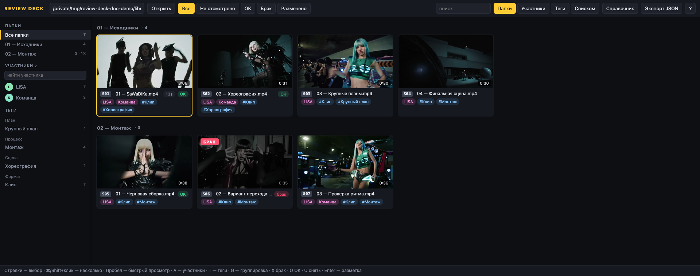
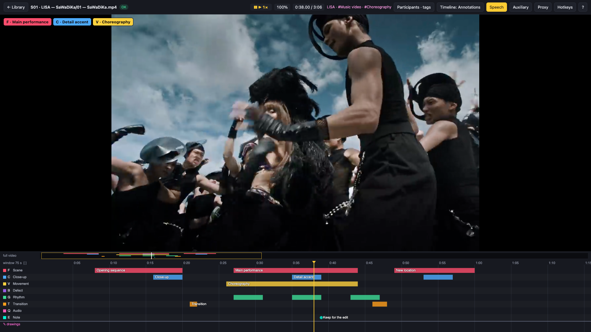
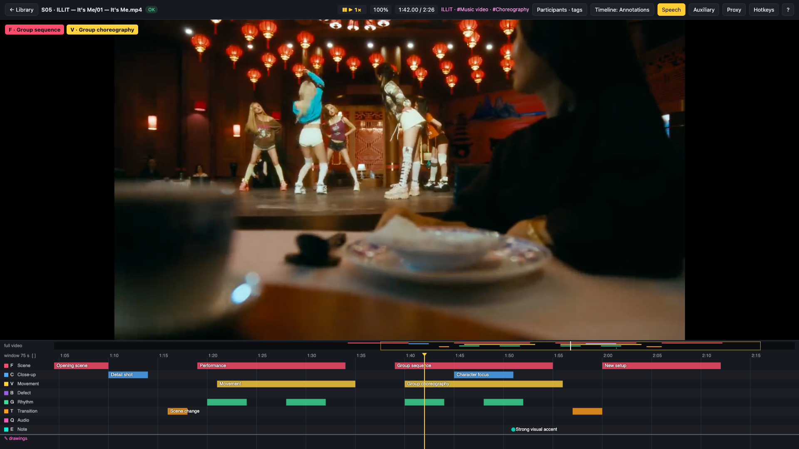
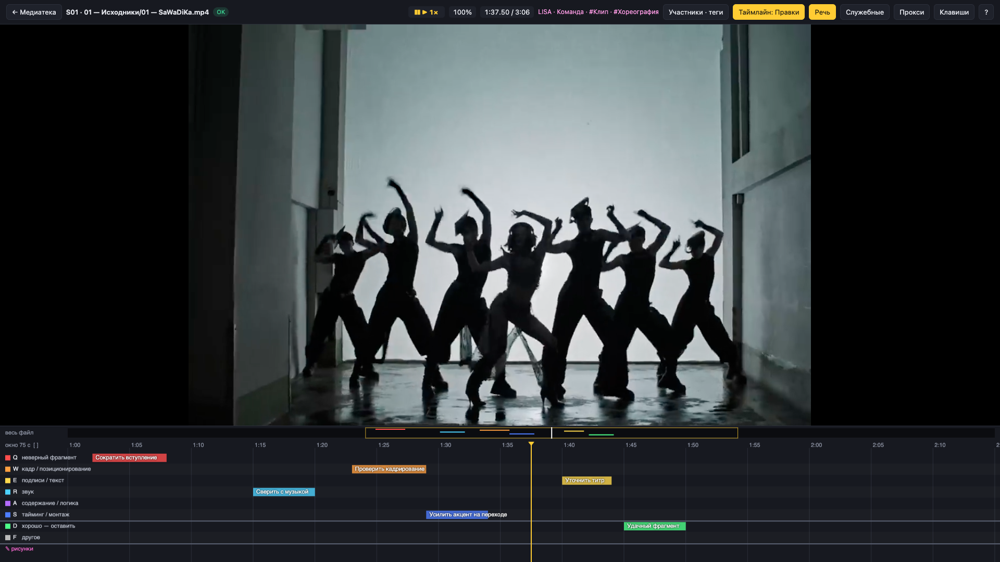

# Review Deck

Review video sources, mark useful moments, and leave precise edit notes in your browser. Review Deck combines a searchable media library, keyboard-driven annotation, frame drawings, and plain JSON exports for editors and automation.

Run it locally or host a shared instance on your own infrastructure. Your videos and review data stay on your storage; the app has no cloud API, telemetry, or CDN dependencies.

## Interface

### Browse and organise sources

Preview clips, filter by participant or tag, group videos, and mark their review status.



### Mark moments on the timeline

Hold a track key to record a time span. Add captions, move several marks together, and step through frames without leaving the player.



### Work with another source

The same tracks and keyboard workflow work across different videos in the library.



### Leave edit notes

Switch to the independent review timeline to flag framing, sound, timing, or content changes.



## Quick start

Requires Python 3.9+ and `ffmpeg` / `ffprobe` on your PATH.

```sh
python3 server.py /path/to/library
# Open http://127.0.0.1:8765
```

Local mode needs no third-party Python packages. You can change the library folder in the app. Subfolders become sections; names starting with `_` or `.` are skipped.

## On-premises deployment

Host one shared instance with Docker Compose, password authentication, a read-only media mount, and a separate persistent data directory. Network mode uses Waitress.

Follow the [deployment guide](docs/ON_PREMISES.md) for setup, HTTPS, migration, backups, and offline installation:

```sh
cp .env.example .env
# Set the library/data paths and create the password file as described in the guide.
docker compose up -d --build
```

The server mode fixes the library path; users cannot change it from the browser. The current model is one shared account and one server instance for a small trusted team. Concurrent edits to the same video use the last save.

## Review data

Local mode stores results in `<library>/_review/`. Server mode stores the same contents in its configured data directory.

| File or directory | Contents |
| --- | --- |
| `marks/<relative path>.json` | Main annotation timeline for each video |
| `marks@review/<relative path>.json` | Independent edit notes |
| `all.json` | Merged export of the main timeline and catalog |
| `drawings/<relative path>/<seconds>.png` | Annotated still frames |
| `config.json`, `config@review.json` | Track labels, colours, and hotkeys |
| `catalog.json` | Participants, tags, and their video links |
| `ids.json` | Optional stable short IDs for the library |
| `avatars/`, `thumbs/`, `sprites/`, `proxy/`, `meta.json` | Rebuildable caches |

Back up the entire data directory, including review timelines and drawings; `all.json` alone is not a full backup.

### Video annotations

```json
{
  "file": "Music video/source.mp4",
  "path": "/library/Music video/source.mp4",
  "status": "ok",
  "note": "Opening sequence selected",
  "duration": 180.0,
  "fps": 30.0,
  "w": 1920,
  "h": 1080,
  "tracks": {
    "F": {
      "label": "Scene",
      "color": "#ff4d6d",
      "spans": [[12.4, 18.9, "Opening shot"], [40.0, 40.0]]
    }
  },
  "drawings": [],
  "updated": "2026-10-23T00:00:00"
}
```

Spans are seconds in the source video. `[t, t]` is a point; the optional third value is a caption. Status is `unreviewed`, `ok`, or `defect`. Drawing strokes use normalised frame coordinates from 0 to 1.

### Participants and tags

```json
{
  "people": {
    "p_speaker": { "name": "Alex Morgan", "aliases": ["Alex"], "note": "Presenter", "avatar": null }
  },
  "tags": {
    "t_interview": { "name": "Interview", "group": "Format" }
  },
  "videos": {
    "interview.mp4": { "people": ["p_speaker"], "tags": ["t_interview"] }
  }
}
```

IDs remain stable when names change. Videos are keyed by their path relative to the library; source files stay in place.

`POST /api/catalog {"ops": [...]}` supports `assign`, `unassign`, `update`, `merge`, and `delete`. Assignment accepts an existing `id` or a new `name`; `"project: Music video"` creates a tag in the `project` group. Updates can change `name`, `aliases`, `group`, `note`, or `avatar`. Merging preserves links and adds the old name as an alias.

Optional `ids.json`, such as `{"source.mp4": "s01"}`, adds short IDs to cards, player titles, and search results.

## Keyboard controls

| Context | Controls |
| --- | --- |
| Library | Arrows to select; Shift or ⌘-click for several; ⌘A for all; Space for quick preview; Enter to open |
| Organisation | A for participants; T for tags; G for grouping; X for defect; O for OK; U to clear status |
| Playback | Space to play/pause; J/K/L to shuttle; arrows to seek; Shift for larger steps; comma/period for frames |
| Annotation | Hold a track key to mark a span; Shift+key to latch start/end; N to caption a selected mark |
| Selection | Shift-drag to select a region; ⌘-click to toggle; Del to delete; ⌘Z to undo |
| Timeline | Wheel to zoom around the pointer; drag to pan; `=` / `-` / `\` for zoom controls |
| Drawing | P to draw on a still frame; Enter to save |
| Review | I for the current video's participants/tags; use the timeline button to switch between annotations and edit notes |

Track hotkeys follow physical keys, including Russian keyboard layouts. A track's stable ID can differ from its `hot` key; changing the hotkey does not rewrite existing marks. Settings support letters, digits, punctuation, and `alt+X` combinations.

The `?` button lists the full controls, including one-handed transport, playback speed, mark navigation, multi-selection, and group nudging. Shift+P builds an all-intra 540p proxy for smoother reverse playback and frame stepping.

## Validation

See the [validation report](docs/VALIDATION.md) for the checks run and their limits.

```sh
python3 -m venv .venv
.venv/bin/pip install -r requirements.txt
.venv/bin/python -m unittest discover -s tests -p 'test_*.py' -v
```

To run the deployment checks through Docker Compose:

```sh
.venv/bin/python tests/container_check.py --build
```

Both suites create temporary synthetic media and leave your library untouched.
