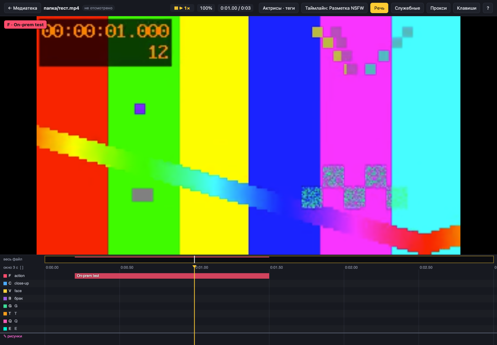

# Проверка on-prem версии — 23 октября 2026

Проверено на синтетическом трёхсекундном видео, пользовательские материалы не использовались.

- Нативный Python 3.12 + Waitress 3.0.2: 14 интеграционных сценариев прошли, включая прежний локальный режим без внешних Python-зависимостей.
- Docker Compose, Linux ARM64: образ собрался; 13 интеграционных сценариев прошли; контейнер healthy до и после перезапуска.
- В контейнере отдельно подтверждены пользователь без root и read-only mount медиатеки.
- Chrome: вход с HTTP Basic, заблокированный выбор серверной папки, загрузка/перемотка видео, сохранение метки с подписью; ошибок JavaScript нет.
- Проверка синтаксиса Python и JavaScript прошла.

Сценарии покрывают защиту UI/API/видео паролем, изоляцию путей и симлинков, HTTP Range/HEAD, обе ленты разметки, настройки, каталог, рисунки, экспорт, метаданные, превью/прокси ffmpeg, параллельные записи, сохранность после перезапуска, отказ при небезопасной конфигурации и проверку origin/размера запросов.

На инфраструктуре заказчика не проверены DNS, TLS-сертификаты, прокси, права NAS, резервное копирование/восстановление и нагрузка больших команд. Развёртывание на целевом сервере не выполнялось. Основные ограничения описаны в [руководстве](ON_PREMISES.md).
